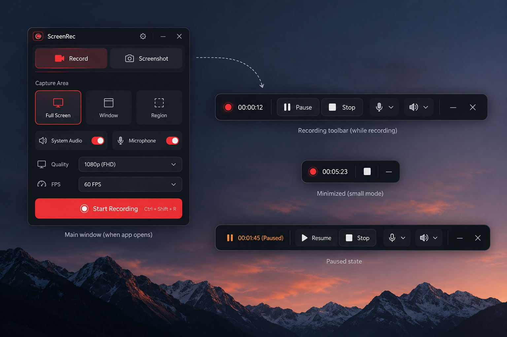

# RecoDex

<p align="center">
  
  <br />
  <strong>Quay video màn hình và chụp ảnh desktop bằng ứng dụng native.</strong>
  <br />
  Xây dựng với Tauri 2, Rust, Svelte 5, Tailwind CSS và shadcn-svelte.
</p>

<p align="center">
  <a href="https://opensource.org/license/mit"></a>
  
</p>





## Giới thiệu

RecoDex là ứng dụng desktop mã nguồn mở để quay màn hình và chụp ảnh màn hình. Giao diện dùng tông tối với điểm nhấn đỏ; các luồng capture, xử lý audio và ghi file được triển khai ở Rust/native backend thay vì xử lý frame video nặng trong JavaScript.

Ứng dụng đang được phát triển với Windows là nền tảng triển khai và kiểm thử chính. Một số luồng vẫn cần kiểm thử trực tiếp trên thiết bị trước khi được xem là hoàn thiện. Workflow phát hành đã cấu hình artifact cho sáu tổ hợp hệ điều hành/kiến trúc, nhưng điều đó **không đồng nghĩa** các capture backend trên macOS và Linux đã được triển khai.

## Tính năng

### Windows

- Quay màn hình, cửa sổ ứng dụng hoặc vùng được chọn bằng Windows Graphics Capture.
- Ghi video H.264/MP4 qua Windows Media Foundation.
- Chụp ảnh PNG/JPEG, lưu vào thư mục đã chọn hoặc sao chép vào clipboard.
- Điều khiển phiên quay bằng toolbar nổi: xem thời gian, pause/resume, stop và truy cập nhanh các điều khiển audio/webcam.
- Chọn microphone và system audio trong Settings; các nguồn audio được xử lý native và trộn vào một track AAC.
- Cấu hình chất lượng và tốc độ khung hình, bao gồm tùy chọn đến 2160p và 60 FPS khi nguồn capture và thiết bị đáp ứng được.
- Settings có các tùy chọn lưu thư mục, chất lượng, audio, phím tắt, screenshot preview và webcam.

### Đang hoàn thiện / thử nghiệm

- **Screenshot Editor:** chú thích, crop và chỉnh sửa ảnh trước khi lưu hoặc sao chép.
- **Video Editor:** preview, timeline, split, trim, delete, undo/redo và export MP4.
- **Webcam Overlay:** chọn camera, xem preview và ghép webcam vào recording.
- **Cursor effects và hold-to-zoom:** thay đổi con trỏ khi quay và zoom theo con trỏ bằng phím giữ.
- **Automatic updates:** kiểm tra và cài bản cập nhật có chữ ký từ GitHub Releases.

Các tính năng trên đã có phần triển khai trong codebase, nhưng một số luồng UI, thiết bị thật, chất lượng video/audio và cài đặt bản cập nhật vẫn chưa được smoke-test đầy đủ. Xem [feature tracker](specs/roadmap/features.md) để biết trạng thái kiểm chứng hiện tại.

## Nền tảng và mức độ hỗ trợ

| Nền tảng | Trạng thái hiện tại |
|---|---|
| Windows x64 | Nền tảng phát triển chính; capture và encoding native đang được triển khai, một số luồng cần kiểm thử runtime bổ sung. |
| Windows ARM64 | Đã có trong ma trận workflow phát hành; chưa xác nhận qua một lần phát hành hoàn chỉnh. |
| macOS Intel / Apple Silicon | Đã cấu hình làm mục tiêu đóng gói; capture adapter chưa được triển khai. |
| Linux x64 / ARM64 | Đã cấu hình làm mục tiêu đóng gói; capture adapter chưa được triển khai. |

Các gói do GitHub Actions tạo ra cần được xem là **artifact thử nghiệm cho đến khi từng target được build và kiểm thử thực tế**. Capture trên macOS/Linux hiện chưa được hỗ trợ.

## Cài đặt

Khi có bản phát hành, tải gói phù hợp với hệ điều hành và kiến trúc của bạn tại [GitHub Releases](https://github.com/duongonix/recodex/releases). Release workflow hiện tạo bản nháp sau khi các job build hoàn tất; các artifact và quy trình cập nhật vẫn cần được xác nhận bằng lần phát hành thực tế đầu tiên.

## Phát triển từ mã nguồn

### Yêu cầu

- Node.js phiên bản LTS và npm.
- Rust stable thông qua `rustup`.
- Bộ phụ thuộc desktop của Tauri 2 cho hệ điều hành đang dùng.
- Trên Windows: Microsoft C++ Build Tools với workload **Desktop development with C++**, WebView2 Runtime và toolchain Rust MSVC.
- Trên macOS: Xcode Command Line Tools hoặc Xcode.
- Trên Linux: GTK/WebKitGTK và các thư viện hệ thống tương ứng với distribution.

Xem danh sách phụ thuộc mới nhất trong [Tauri 2 prerequisites](https://v2.tauri.app/start/prerequisites/).

### Chạy ứng dụng ở chế độ phát triển

```sh
git clone https://github.com/duongonix/recodex.git
cd recodex
npm ci
npm run tauri dev
```

Các lệnh kiểm tra frontend:

```sh
npm run check
npm run lint
npm run test
npm run build
```

Kiểm tra và build Rust/Tauri:

```sh
cargo fmt --manifest-path src-tauri/Cargo.toml --all -- --check
cargo check --manifest-path src-tauri/Cargo.toml
npm run tauri build
```

`npm run build` chỉ build frontend. `npm run tauri build` tạo ứng dụng desktop cho target hiện tại và cần cài đủ dependency native của nền tảng.

## Phát hành

Workflow [`.github/workflows/release.yml`](.github/workflows/release.yml) được kích hoạt khi push tag phiên bản dạng `vX.Y.Z`. Phiên bản trong `package.json`, `src-tauri/tauri.conf.json` và `src-tauri/Cargo.toml` phải giống nhau và khớp tag.

Ma trận hiện tại:

| Hệ điều hành | Kiến trúc | Gói dự kiến |
|---|---|---|
| Windows | x64, ARM64 | NSIS installer |
| macOS | Intel x64, Apple Silicon ARM64 | DMG |
| Linux | x64, ARM64 | AppImage, DEB, RPM |

Workflow yêu cầu repository secret `TAURI_SIGNING_PRIVATE_KEY`; nếu private key có password thì cần thêm `TAURI_SIGNING_PRIVATE_KEY_PASSWORD`. Không commit private key vào repository. Workflow tạo draft release và chỉ publish sau khi toàn bộ sáu build target thành công. Cấu hình updater và giới hạn nền tảng được mô tả trong [tài liệu phát hành](specs/updates/01-github-releases.md).

## Kiến trúc dự án

- `src/` — giao diện Svelte 5, state và frontend features.
- `src-tauri/src/` — Tauri commands, capture, audio, encoding, settings và xử lý file native.
- `src-tauri/icons/` — icon bundle cho các nền tảng desktop.
- `specs/` — yêu cầu sản phẩm, kiến trúc, UI, roadmap và trạng thái kiểm chứng.
- `.github/workflows/` — kiểm tra chất lượng và workflow phát hành.

RecoDex dùng Windows Graphics Capture và Media Foundation cho pipeline Windows. Capture, xử lý frame, audio và ghi file chạy trong Rust/native backend; frontend dùng typed Tauri IPC để điều khiển ứng dụng và hiển thị trạng thái.

## Quyền riêng tư

Ảnh, video và audio được xử lý và lưu trên thiết bị của người dùng. RecoDex không có dịch vụ upload recording lên cloud. Bản desktop có thể truy cập GitHub Releases để kiểm tra cập nhật; chức năng updater chỉ cài artifact có chữ ký hợp lệ.

## Đóng góp

Issue và pull request được hoan nghênh. Trước khi thay đổi capture hoặc media pipeline, vui lòng đọc [`AGENTS.md`](AGENTS.md), các tài liệu trong [`specs/`](specs/) và cập nhật roadmap khi trạng thái tính năng thay đổi. Không đánh dấu một luồng là hoàn thành nếu chưa có kết quả build/test hoặc kiểm thử runtime phù hợp.

## Giấy phép

RecoDex được phát hành theo giấy phép [MIT](LICENSE), một giấy phép mã nguồn mở được Open Source Initiative công nhận. Các dependency bên thứ ba có giấy phép riêng; hãy tham khảo thông tin của từng dependency.

## Liên hệ

- Tác giả: [DuongOnix](https://fb.com/duongonix)
- Email: [duongonixx@gmail.com](mailto:duongonixx@gmail.com)
